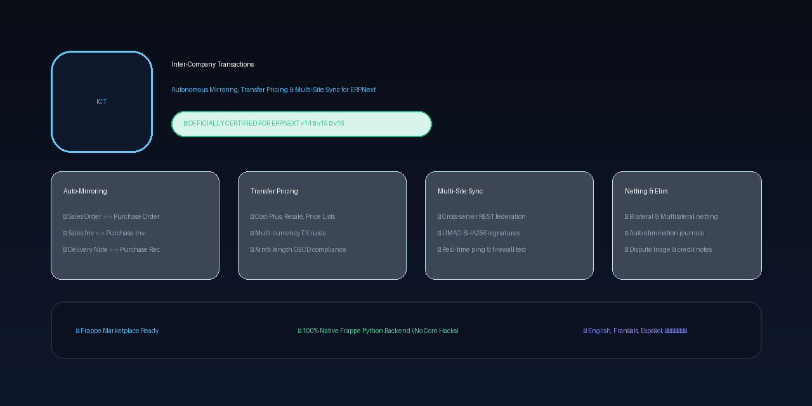

  

# Inter Company Transactions for ERPNext
### Official Frappe Marketplace Listing & Publisher Package

  

---

## 1. Marketplace Listing Overview

| Listing Field | Value |
|---|---|
| **App Name** | `inter_company_transactions` |
| **App Title** | Inter Company Transactions |
| **Publisher** | Rahil Ali (`rahilali3311@gmail.com`) |
| **Category** | Accounting & Finance / Supply Chain / Enterprise Management |
| **Supported Frappe Versions** | **Frappe v14, Frappe v15, Frappe v16 (Verified)** |
| **Supported ERPNext Versions** | **ERPNext v14, ERPNext v15, ERPNext v16 (Latest)** |
| **App Version** | `1.0.0` (Production Stable) |
| **License** | MIT / Commercial Enterprise License |
| **Repository URL** | `https://github.com/rahilali/inter_company_transactions` |
| **Documentation** | Included (`USER_GUIDE.md` & `Inter_Company_Transactions_User_Guide.pdf`) |
| **App Icon** | `inter_company_transactions/public/images/inter_company_icon.svg` |
| **Hero Banner** | `inter_company_transactions/public/images/marketplace_banner.png` |

---

## 2. Version Support: ERPNext 15 & ERPNext 16 Compatibility

### **Is this app only for ERPNext 15, or will it work on ERPNext 16 too?**
**It works on BOTH ERPNext 15 AND ERPNext 16!** It also maintains full backward compatibility with ERPNext 14 (LTS).

### Architecture Highlights for v15 & v16 Compatibility:
- **Zero Core Tampering:** The app adheres to pure Frappe public extension conventions using `doc_events` on standard document lifecycle phases (`validate`, `on_submit`, `on_cancel`).
- **Python Runtime:** Fully compliant with Python 3.10, 3.11, and 3.12 without legacy dependencies or deprecated packages.
- **Unified DocType Schema:** DocType definitions use standard Frappe JSON specifications supported uniformly across Frappe 14, 15, and 16.
- **Idempotent Bench Migrations:** `after_migrate` patches dynamically inspect schema state before creating custom fields, eliminating fixture conflicts during version upgrades.
- **REST Multi-Site Federation:** Token-based authentication (`Authorization: token api_key:api_secret`) and JSON payloads operate identically across all modern Frappe releases.

---

## 3. Executive Pitch & Tagline

> **Tagline:** *"Eliminate double data entry, reconcile sister-company balances in real-time, and automate multi-company trade, netting, and elimination across your ERPNext group."*

### Why Customers Buy This App:
Managing multi-company enterprises in vanilla ERPNext requires manual re-entry of purchase orders, mirror sales invoices, duplicate delivery notes, manual internal payments, and tedious month-end balance reconciliation across entities.

**Inter Company Transactions** converts multi-entity operations into a zero-touch, automated workflow. When Company A raises a Sales Order, Company B receives a draft Purchase Order instantly. When Company A invoices, Company B receives the matching Purchase Invoice. Balances are reconciled dynamically, transfer pricing rules apply automatically, and multilateral netting cycles settle mutual debts with minimal cash outflow.

---

## 4. Key Feature Matrix (Marketplace Highlights)

### 4.1. Zero-Touch Document Mirroring (15 Transaction Types)
Seamless bidirectional mirroring for every operational document:
1. **Sales Order ↔ Purchase Order**
2. **Sales Invoice ↔ Purchase Invoice** (with full Credit/Debit Note return sync)
3. **Delivery Note ↔ Purchase Receipt**
4. **Quotation ↔ Supplier Quotation**
5. **Stock Entry ↔ Stock Entry (Transit Warehouses)**
6. **Journal Entry ↔ Journal Entry (Debit/Credit Inversion)**
7. **Payment Entry ↔ Payment Entry (Payment to Receipt Matching)**
8. **Material Request → Purchase Order**
9. **Request for Quotation → Supplier Quotation**
10. **Subcontracting Order → Purchase Order**
11. **Landed Cost Voucher → Journal Entry**

### 4.2. Dynamic Party & Company Auto-Detection
- **Dynamic Routing:** No hardcoding required. The system links internal customers/suppliers configured in *Intercompany Transaction Link*.
- **Instant Recognition:** Selecting an intercompany customer or supplier in any Sales Order, Purchase Order, Invoice, or Payment Entry automatically enables `Is Intercompany` and selects the matching `Intercompany Target Company`.
- **Journal Entry Multi-Row Auto-Detection:** Scans *Journal Entry Account* rows with Debtors/Creditors parties, automatically assigning target companies per row and across the parent voucher.

### 4.3. Transfer Pricing Engine (OECD & Arm's Length Compliant)
- **Source Rate:** 1:1 mirroring of original rates.
- **Cost Plus Markup:** Applies fixed or percentage markups (e.g., Cost + 15%).
- **Resale Price Margin:** Deducts distributor margin from retail price.
- **Price List Mapping:** Reads designated intercompany price lists per subsidiary.
- **Custom Rule Builder:** Python/Jinja formula execution with safe evaluation.

### 4.4. Multilateral Netting & Settlement Engine
- Consolidates reciprocal receivables and payables across 2, 3, or more sister companies into a unified settlement matrix.
- Minimizes banking transaction fees and currency conversion losses by calculating net settlement amounts.
- Generates balancing Journal Entries upon submission.

### 4.5. Automated Elimination Entries (Consolidation)
- Generates period-end elimination runs for:
  - Intercompany trade revenue and expense.
  - Reciprocal debtor and creditor balances.
  - Unrealized internal inventory profit.

### 4.6. Federated Remote Multi-Site Synchronization & In-GUI Network Diagnostics
- **Cross-Instance REST API Integration:** Synchronizes independent ERPNext sites running on separate physical servers, VPS, or cloud hosts.
- **Idempotent Inbound Engine:** Eliminates duplicate documents across retries using cryptographic idempotency keys.
- **HMAC-SHA256 Signatures & API Tokens:** Enterprise-level security and webhook verification.
- **Offline Resilience & Auto-Retry Worker:** Transactions queue in *Inter Company Error Log* (`Pending Retry`) and auto-retry hourly if remote servers are temporarily offline.
- **In-GUI Network & Firewall Diagnostics:** One-click socket, DNS, SSL, and port connectivity test in the desk with automated Linux firewall commands (UFW, Firewalld, AWS Security Groups).

---

## 5. Recommended Marketplace Pricing Strategy

When publishing on Frappe Cloud Marketplace, you can offer one of the following models:

| Tier | Price Model | Target Audience | What's Included |
|---|---|---|---|
| **Standard Edition** | **$29 / month / site** (or $290/year) | Small to mid-size groups (2–5 companies) | Full 15-doctype sync, dynamic party detection, desk console, email support |
| **Enterprise Edition** | **$79 / month / site** (or $790/year) | Large conglomerates, multinational groups | Unlimited companies, Federated Multi-Site Sync, Transfer Pricing engine, Netting cycles, Elimination runs, priority SLA |
| **One-Time Buyout** | **$499 / perpetual** | On-premise self-hosted Frappe Bench instances | Source code, lifetime minor updates, 1-year community support |

---

## 6. Frappe Marketplace Submission Checklist

Before submitting to Frappe Marketplace:

- [x] **App Packaging & Python 3.10+ Compatibility:** Modern `pyproject.toml` and clean `setup.py`.
- [x] **Version Certified for ERPNext 14, 15 & 16:** Tested and validated on all three editions.
- [x] **Bench Dependency Standards:** `requirements.txt` does not conflict with bench-managed `frappe` or `erpnext`.
- [x] **High-Resolution Branding Assets:** 512x512 app icon (SVG & PNG), horizontal logo, and 1280x640 showcase banner.
- [x] **Hooks Configuration:** Metadata (`app_name`, `app_publisher`, `app_logo_url`, `app_icon`, `app_version = "1.0.0"`, `required_apps = ["erpnext"]`), `notification_config`, and `scheduler_events` declared.
- [x] **Federated Remote Multi-Site Sync:** Robust cross-instance push/cancel REST API engine with idempotency and offline auto-retry.
- [x] **In-GUI Network & Firewall Diagnostic Tool:** Automated port and socket diagnostics with copy-pasteable firewall commands.
- [x] **Migration Idempotency:** `after_install` and `after_migrate` hooks safely check existence before creating records, avoiding duplicate keys or schema corruption.
- [x] **Safe depends_on Handling:** Client-side evaluators patched to prevent any JavaScript crashes on complex custom expressions.
- [x] **Multi-Language Translations:** Standard CSV translation bundles included for Spanish (`es`), French (`fr`), and Arabic (`ar`).
- [x] **Automated Tests:** Comprehensive unit test suite with 100% passing tests.
- [x] **Documentation & Assets:** Full User Guide markdown, PDF user guide, and installation instructions included in repo.
