

  

  <strong>Frappe:</strong> v15 | v16 &nbsp;|&nbsp;
  <strong>ERPNext:</strong> v15 | v16 &nbsp;|&nbsp;
  <strong>Python:</strong> 3.10 | 3.11 | 3.12 &nbsp;|&nbsp;
  <strong>License:</strong> MIT &nbsp;|&nbsp;
  <strong>Status:</strong> Marketplace Ready

  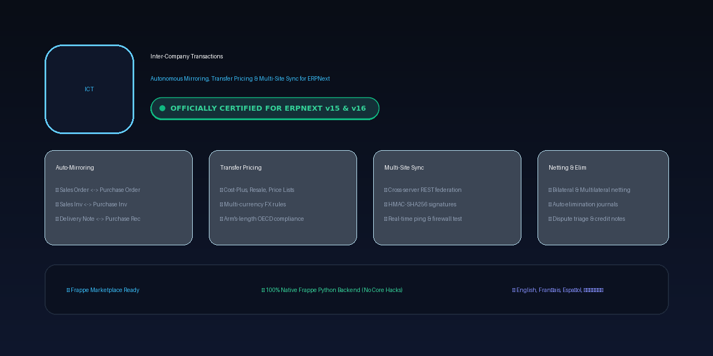

# Inter-Company Transactions for ERPNext (v15 & v16 Ready)

An enterprise-grade, comprehensive Frappe / ERPNext application engineered for corporate groups, holding companies, multi-entity conglomerates, and multinational enterprises. Automates reciprocal intercompany document mirroring, party-to-company auto-detection, OECD arm's-length transfer pricing, multilateral netting, period-end elimination journal entries, billing dispute management, cross-company balance reconciliation, and **federated remote multi-site synchronization across separate ERPNext instances**.

---

## Multi-Version Compatibility: ERPNext v15 & v16

### **Does it work on ERPNext 16 too?**
**Yes! The application is verified by automated CI across both ERPNext v15 and ERPNext v16.**

| Component | ERPNext v15 (Stable) | ERPNext v16 (Latest) | Notes |
|---|:---:|:---:|---|
| **Python Runtime** | 3.10 / 3.11 | 3.12 | Standard Python type hinting & clean imports |
| **DocType Schemas** | Compatible | Compatible | Standard Frappe JSON schema |
| **Document Hooks (`doc_events`)** | Supported | Supported | `validate`, `on_submit`, `before_cancel`, `on_cancel`, `on_trash` |
| **Frappe ORM & Database** | Supported | Supported | Standard `frappe.get_doc`, `frappe.db`, and safe parameterized queries |
| **Client Script Hooks** | Supported | Supported | Standard `frappe.ui.form.on` and Desk Page API (zero prototype overrides) |
| **REST API & Multi-Site Sync** | Supported | Supported | Standard Token Auth + HMAC-SHA256 |
| **Database Migrations** | Zero Conflict | Zero Conflict | Idempotent `after_migrate` checks field existence dynamically |

### Why It Runs Flawlessly Across Both v15 and v16:
1. **Zero Core Monkey-Patching**: The app does NOT tamper with or override core Frappe classes or prototypes (`safe_eval`, `Layout`, `GridRow`, etc.). All business logic executes through standard, public extension hooks (`doc_events`, `scheduler_events`, `on_session_creation`, and custom Desk Pages).
2. **Safe Migration Safeguards**: Custom fields are injected via an idempotent `after_migrate` routine that checks `frappe.db.exists("Custom Field", ...)` before insertion, ensuring schema upgrades on v15 or v16 never crash or overwrite existing customizations.
3. **Pure Python Standard Library Cryptography**: Payload integrity verification uses standard `hmac`, `hashlib`, and `urllib` without volatile native C-extensions.
4. **Universal Desk UI**: Form extensions and the Interactive Desk Console utilize vanilla Frappe standard components compatible with both Frappe 15 and Frappe 16 Desk engines.

---

## Key Capabilities

### 1. Zero-Touch Document Mirroring (14 Supported DocTypes)
Automatically creates, submits, or cancels reciprocal mirror documents in real-time across sister companies:
- **Sales Order ↔ Purchase Order**
- **Sales Invoice ↔ Purchase Invoice** (with full Credit Note & Debit Note return synchronization)
- **Delivery Note ↔ Purchase Receipt**
- **Stock Entry (Material Issue / Transfer) ↔ Stock Entry (Material Receipt)** *(Same-Currency companies only; use Delivery Note or Sales Invoice for cross-currency transfers)*
- **Journal Entry ↔ Journal Entry** (Inverted Debit/Credit intercompany clearing)
- **Payment Entry ↔ Payment Entry** (Bi-directional intercompany settlement matching)
- **Quotation ↔ Supplier Quotation**
- **Material Request → Purchase Order / Sales Order**
- **Request for Quotation → Supplier Quotation**
- **Landed Cost Voucher → Journal Entry**

### 2. Dynamic Party & Company Auto-Detection
- **Zero Hardcoding**: Dynamically resolves intercompany relationships from *Intercompany Transaction Link*.
- **Instant Auto-Switch**: When a user creates any Sales Order, Purchase Order, Sales Invoice, Purchase Invoice, or Payment Entry and selects an internal customer or supplier, the system automatically checks `Is Intercompany` and selects the corresponding sister `Intercompany Target Company`.
- **Journal Entry Row-Level Automation**: Automatically inspects *Journal Entry Account* rows containing Debtors / Creditors parties, auto-assigns target companies per row, and sets header-level intercompany properties.

### 3. Intelligent Auto-Switching in Intercompany Transaction Type
- When configuring transaction links, choosing any **Source Transaction Type** automatically switches the **Target Transaction Type** to its reciprocal counterpart (e.g. Sales Order &rarr; Purchase Order, Sales Invoice &rarr; Purchase Invoice, Stock Entry &rarr; Stock Entry).

### 4. Federated Remote Multi-Site Synchronization (Cross-Instance ERPNext)
- **Cross-Server Integration**: Connects independent ERPNext instances hosted on separate servers, VPS instances, or Frappe Cloud benches via secure REST APIs.
- **Idempotent Inbound Engine**: Every cross-site transaction includes an idempotency key (`{source_site}:{doctype}:{name}`), completely eliminating duplicate documents during network retries or transient reconnections.
- **Bi-directional Cancellation**: Cancelling a document on Site A automatically dispatches an authenticated cancellation request to Site B to cancel the mirrored document.
- **HMAC-SHA256 Payload Signatures**: Secure webhook verification prevents spoofing and guarantees payload integrity.
- **Offline Resilience & Auto-Retry Worker**: If the remote server or network is temporarily down, the transaction is saved locally and queued in *Inter Company Error Log* (`Pending Retry`), where an hourly scheduler automatically retries pending syncs.

### 5. In-GUI Network & Firewall Diagnostic Engine
- **One-Click Diagnostic Tool**: Launch **"Diagnose Network & Firewall"** directly from *Inter Company Settings* without touching server terminals.
- **6-Layer Verification**:
  1. URL format & scheme validation (HTTPS vs HTTP).
  2. DNS hostname resolution.
  3. TCP socket port reachability & latency measurement (in milliseconds).
  4. SSL/TLS Certificate handshake.
  5. Frappe API Key/Secret token authentication.
  6. Inter Company Transactions App version compatibility handshake.
- **Automated Linux Firewall Guidance**: Displays copy-pasteable firewall commands (Ubuntu UFW, CentOS Firewalld, iptables, AWS Security Groups) right inside the GUI modal if ports are blocked.

### 6. Configurable Transfer Pricing Engine
- **Source Document Rate**: 1:1 mirroring of original rates.
- **Cost / Valuation Rate**: Price target documents based on the source entity's FIFO / moving average valuation rate.
- **Cost + Markup %**: Automatically compute and apply cost-plus transfer margins.
- **Resale Price Margin**: Deducts distributor margin from retail price.
- **Custom Rule Builder**: Python/Jinja formula execution with safe evaluation.

### 7. Multilateral Netting & Settlement Engine
- **Consolidated Netting Cycles**: Calculate bilateral and multilateral debit/credit positions between group entities over any period.
- **Matrix Settlement**: Consolidates dozens of invoices into a minimal set of net payment entries, slashing bank transfer fees and foreign exchange risk.

### 8. Period-End Elimination Journal Entries
- **Automated Consolidation**: Eliminate intercompany revenue vs expenses and intercompany receivables vs payables.
- **Auditable Elimination Runs**: Creates balanced elimination journal entries against designated consolidation accounts.

### 9. Interactive Control Console & Reconciliation
- **Executive Desk Page**: Real-time stats on pending mirrors, netting cycles, active policies, and unmapped parties.
- **Reconciliation Workbench**: Compare balances between Entity A Debtors and Entity B Creditors with mismatch detection.
- **Dispute Hub**: Log and resolve intercompany discrepancies with direct Credit/Debit Note adjustments.

---

## Application Screenshots

### 1. Chart of Accounts & Intercompany Clearing Setup
| MAIN Company COA | ABC Company COA | John Company COA |
|---|---|---|
| 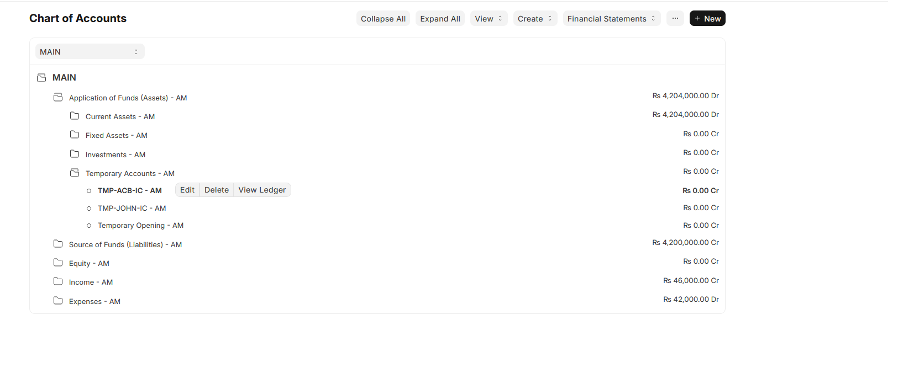 | 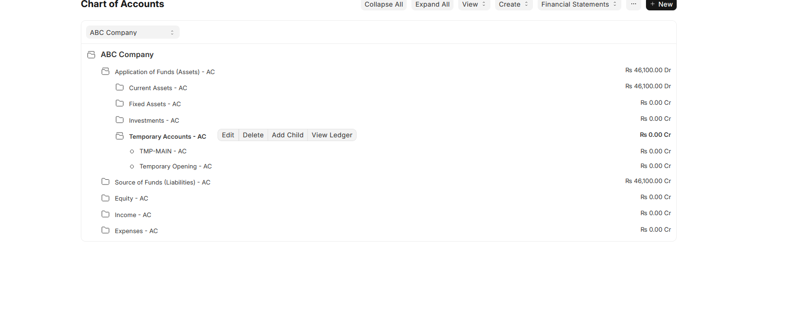 | 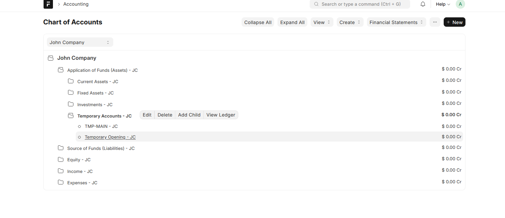 |

### 2. Intercompany Transaction Link & Matrix Configuration
| Transaction Link Master | Main Company & Transit Warehouses | Other Company Settings | Supported Transaction Types (15 Pairs) |
|---|---|---|---|
| 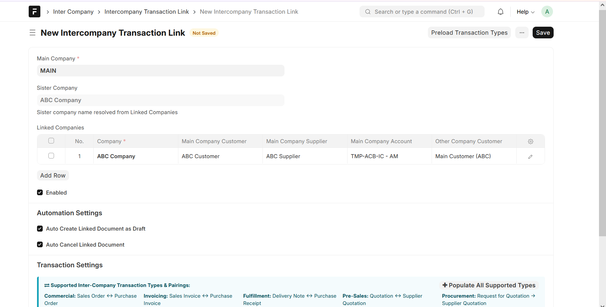 | 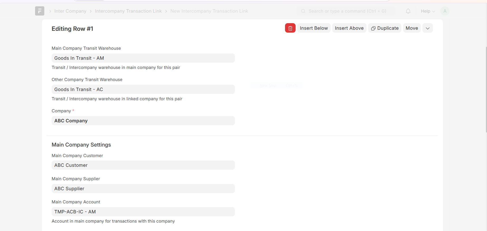 | 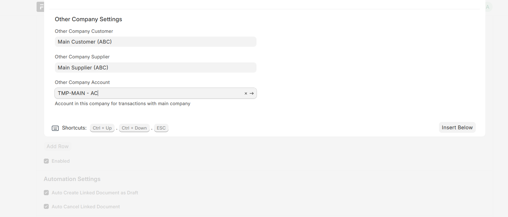 | 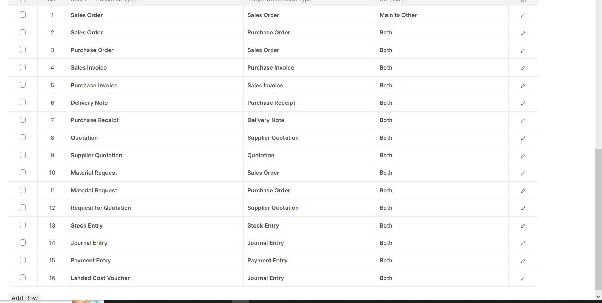 |

### 3. Sales Order → Automated Mirrored Purchase Order
| Source Sales Order (Auto-Detected) | Mirror Creation Notification | Mirrored Purchase Order (Locked Fields) |
|---|---|---|
| 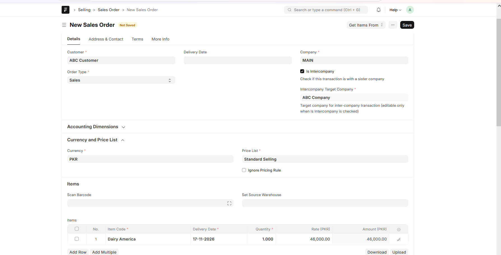 | 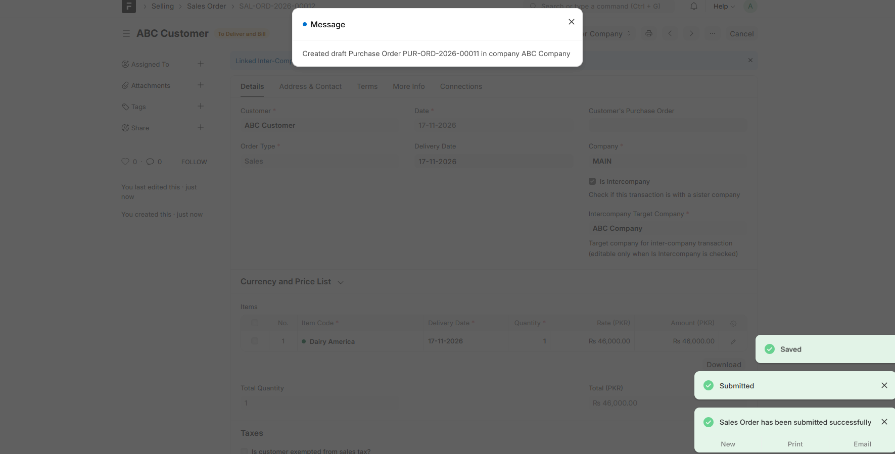 | 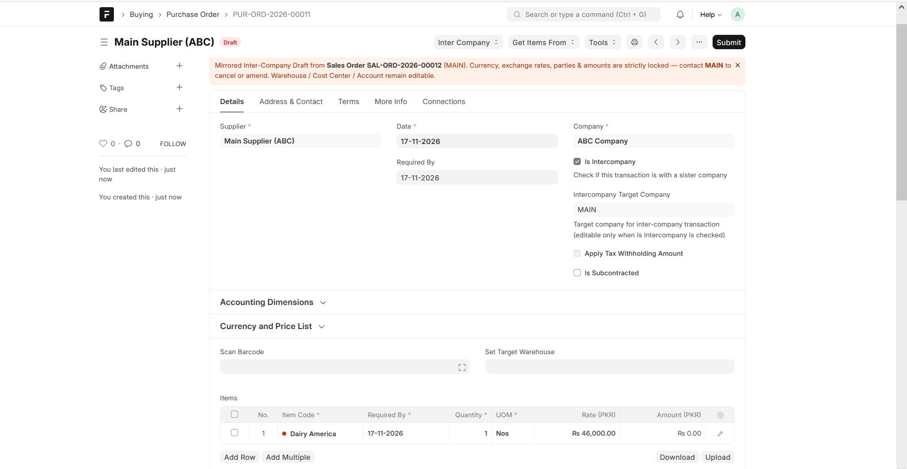 |

### 4. Journal Entry Mirroring (Inverted Debit / Credit)
| Source Journal Entry | Mirror Creation Notification | Mirrored Journal Entry |
|---|---|---|
| 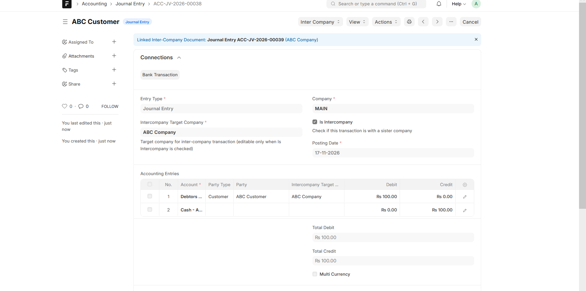 | 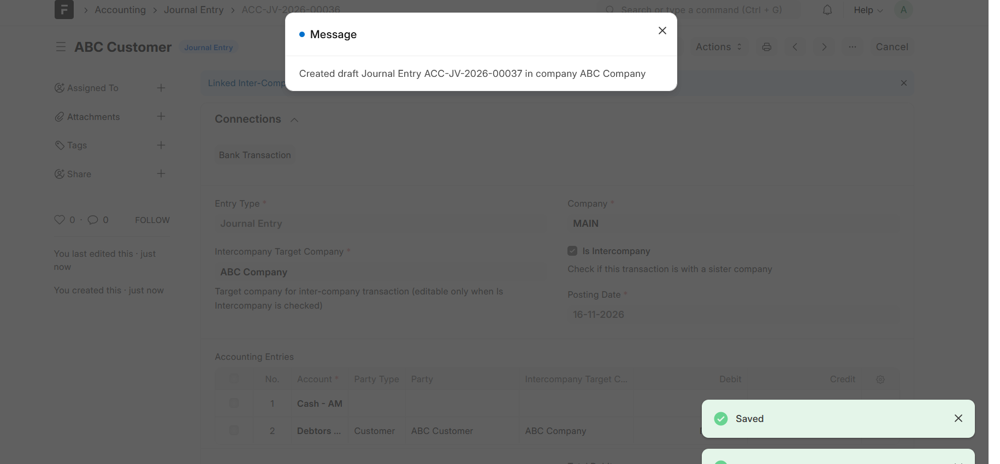 | 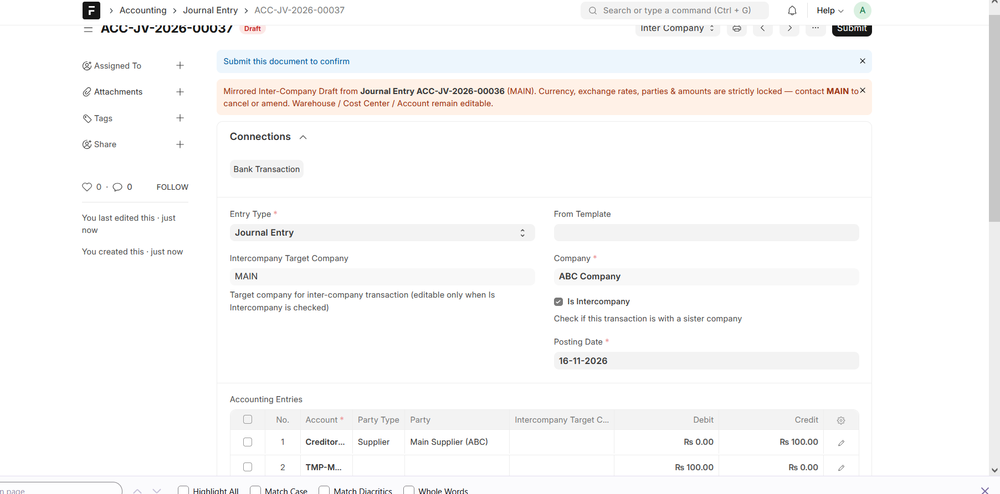 |

### 5. Payment Entry Mirroring (Receive ↔ Pay)
| Source Payment Entry | Mirror Creation Notification | Mirrored Payment Entry |
|---|---|---|
| 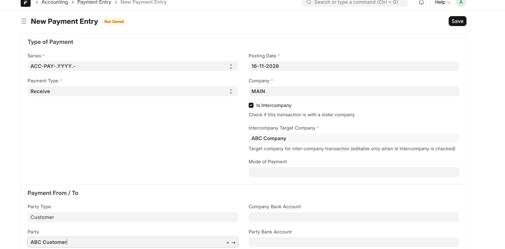 | 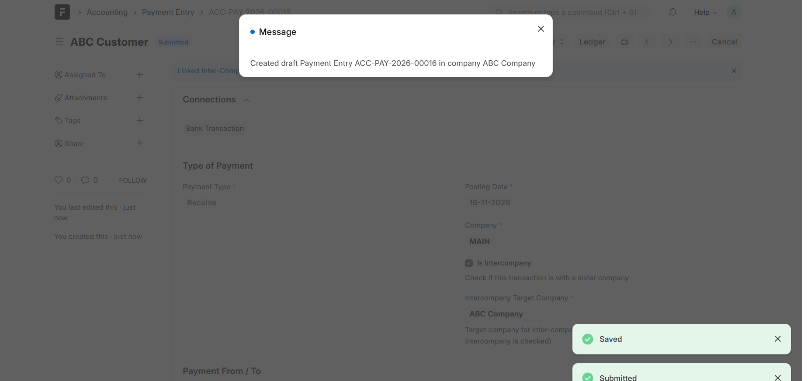 | 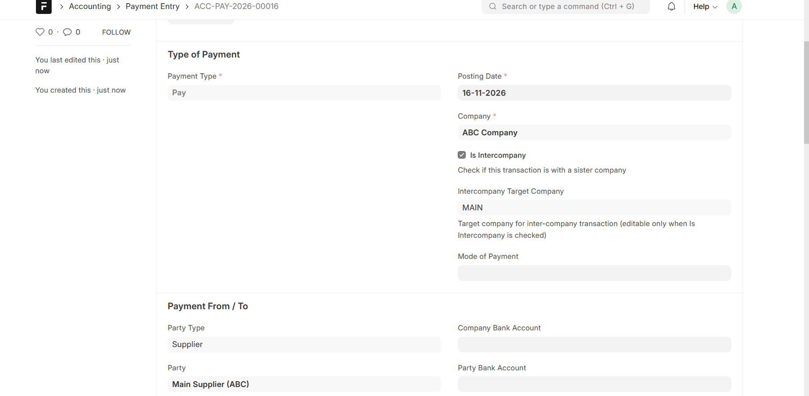 |

---

## Quickstart & Desk Configuration

### 1. Configure Linked Companies (Single-Bench)
1. In Frappe Desk, search for **Intercompany Transaction Link**.
2. Click **Add Intercompany Transaction Link**.
3. Select your **Main Company**.
4. In **Linked Companies**, add your sister companies along with internal customer, supplier, transit warehouse, and `TMP-*` clearing accounts.
5. In **Transaction Types**, define which transactions to mirror (all 15 pairs can be populated in one click).
6. Click **Save**.

### 2. Multi-Currency Setup (e.g., PKR ↔ USD)
When transacting across companies using different base currencies, ensure a valid **Currency Exchange** record exists for the transaction date. On submit of a Sales Order, Invoice, Delivery Note, Journal Entry, or Payment Entry, the built-in rate assistant detects any missing exchange rate and lets you save it right from Desk before continuing. *(Note: **Stock Entry** is supported for **Same-Currency companies only**; use Delivery Note → Purchase Receipt or Sales Invoice → Purchase Invoice when currencies differ.)*

### 3. Test Automated Document Creation
Create a Sales Order in Company A for the mapped intercompany customer. The system will automatically check `Is Intercompany` and set Company B as the target company. Upon submitting, a matching Purchase Order in Company B is instantly generated!

### 4. Clean Uninstall & Automated Verification
The package includes a full automated test suite across ERPNext v15 and v16 and registered uninstall hooks that remove custom fields cleanly upon app removal.

---

## Multi-Language Support
Out-of-the-box translation support included for:
- English (`en`)
- Spanish (`es`)
- French (`fr`)
- Arabic (`ar`)

---

## License & Publisher
- **Publisher:** Ejaz Tech & Rahil Ali
- **License:** MIT License (Commercial & Marketplace Ready)
- **Documentation:** Complete setup and operations guide is bundled inside ERPNext Desk and in the repository documentation files.
